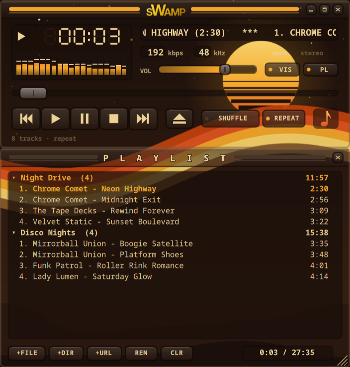
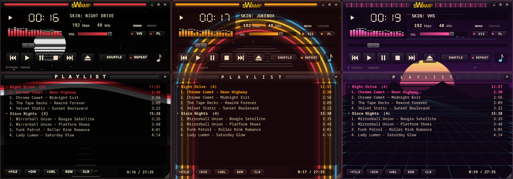
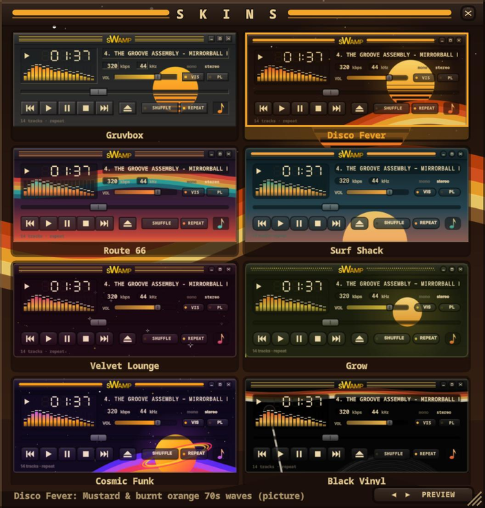

# sWamp

A retro, late-90s style music player for [Omarchy](https://omarchy.org), built with Quickshell.
It has a spectrum analyzer, a playlist with a folder view for big libraries, and 20 vintage picture skins.
A gold **sWAMP** button in the Omarchy bar opens it, brings it to you or minimizes it, and its tooltip shows what's playing.



<p align="center"></p>

## Install

```bash
omarchy plugin add https://github.com/gasserx/swamp --enable
```

That's all you need for the bar button and the player.
For the extras (a `swamp` command, an app-launcher entry, and a Hyprland window rule), run:

```bash
~/.config/omarchy/plugins/gasserx.swamp/install.sh                    # extras
~/.config/omarchy/plugins/gasserx.swamp/install.sh --default-player   # extras + open audio files in sWamp
```

**Update:** `omarchy plugin update gasserx.swamp`
**Remove:** run `uninstall.sh` from the plugin folder, then `omarchy plugin remove gasserx.swamp`

### Requirements

Omarchy (Hyprland + the Omarchy shell) already ships most of these: `quickshell`, `qt6-multimedia-ffmpeg`, `ffmpeg` (for `ffprobe`), PipeWire (for `pw-record`, which feeds the analyzer), `jq` and `python3`.
`install.sh` checks for them and tells you what's missing.

## Features

- Plays MP3, FLAC, OGG/Opus, M4A/AAC, WAV, WMA and more, plus `.m3u` playlists and http(s) streams
- Live 19-band spectrum analyzer with falling peaks (reads PipeWire's sink monitor, no extra packages)
- Playlist with **folder view**: libraries spread over several folders show collapsible folders with track counts and total time. Handles 20 000+ tracks, and tags are probed in parallel and cached.
- **Search** the playlist (FIND, `/` or Ctrl+F): filters by artist, title, file or folder name as you type, without changing the play order
- Drag & drop, **+FILE / +DIR / +URL**, mounted network shares
- 20 vintage picture skins with a skin picker (snapshot of the player in each skin) and a live preview bar
- Resizable (corner grip, Ctrl + wheel, Ctrl +/−/0); maximize keeps the Omarchy bar visible and stretches the layout
- Minimize works like a taskbar: the window parks on a hidden workspace and the bar button brings it back
- Remembers the playlist, position in the list, volume, skin and size

<p align="center"></p>

## Keys

| Key | Action | Key | Action |
|---|---|---|---|
| Z | previous | B | next |
| X | play | C | pause |
| V | stop | Space | play / pause |
| ← / → | seek 5 s | ↑ / ↓ | volume |
| S | shuffle | R | repeat |
| L | add files | Delete | remove selected |
| Enter | play selected | Ctrl+A | select all |
| K / Shift+K | browse skins | F11 | maximize |
| / or Ctrl+F | search the playlist | Esc | clear search / close picker / cancel browse |
| Ctrl + / − / 0 | size bigger / smaller / reset | | |

In the search box: ↑ / ↓ move through the matches, Enter plays one, Esc clears the search.

Right-click the title bar or click the ♪ badge to open the skin picker.

## Command line

```bash
swamp song.mp3 ~/Music/Album     # play these (replaces the playlist)
swamp --enqueue more.flac         # add to the playlist
swamp ipc toggle                  # play/pause; also: play pause stop next prev
swamp ipc status                  # "playing<TAB>Artist - Title"
swamp ipc skin vhs                # switch skin (list them with: swamp ipc skins)
swamp ipc scale 2                 # window size
swamp ipc search "live usa"       # filter the playlist (swamp ipc searchClear to reset)
swamp ipc minimize | restore | fullscreen | quit
```

Without `install.sh`, use `~/.config/omarchy/plugins/gasserx.swamp/bin/swamp`.
`SWAMP_SCALE=2 swamp` overrides the default size.

Settings and playlist: `~/.local/state/swamp.json`. Tag cache: `~/.cache/swamp/tags.json`.

## Making skins

Skins live in `app/skins/skinpack.json`: each one is a set of colours plus optional `bgImage` / `bgOpacity` for a picture behind the panels.
The pictures are drawn by `app/skins/art/gen.py` (SVG rendered with `rsvg-convert`). Run `python3 gen.py <skin-id>` to re-render one.
Skin keys that aren't set fall back to the defaults in `app/Skin.qml`.
After adding or changing a skin, run `app/skins/snap.sh` to re-render the picker previews (`app/skins/snap/<id>.jpg`).

## License

MIT, see [LICENSE](LICENSE). sWamp is an independent project with its own artwork. It is not affiliated with Winamp or any other player.
